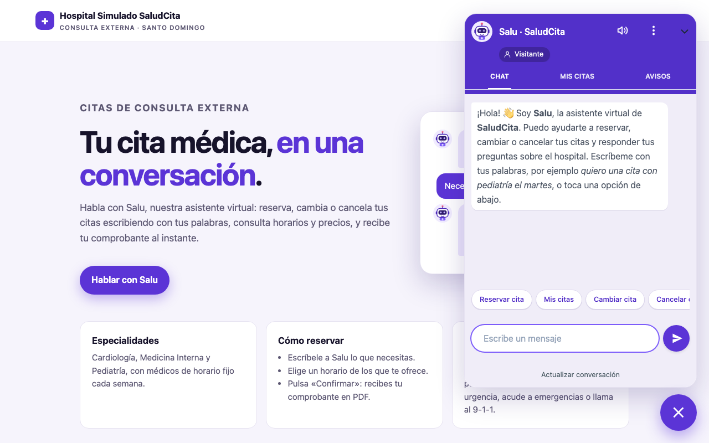
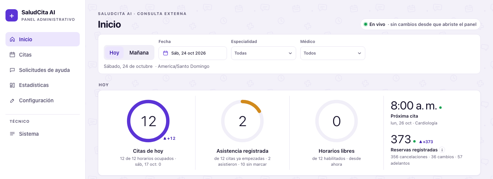
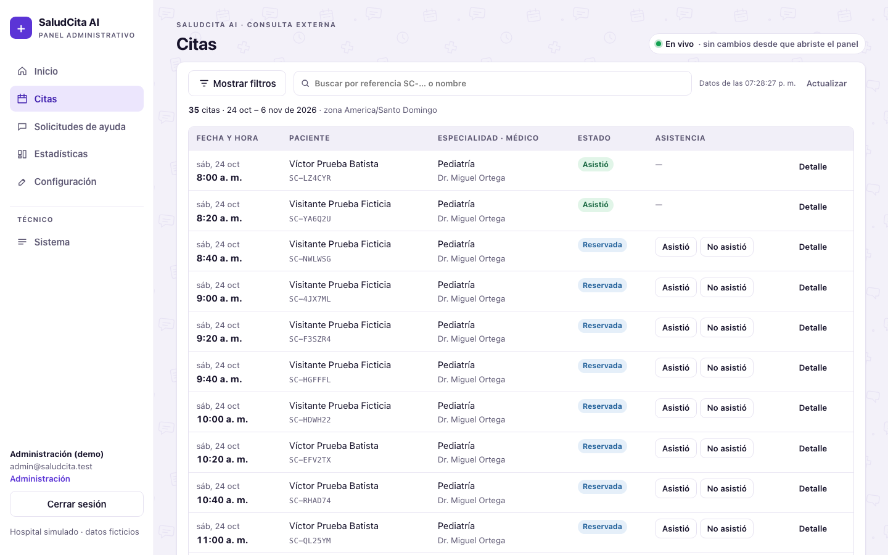
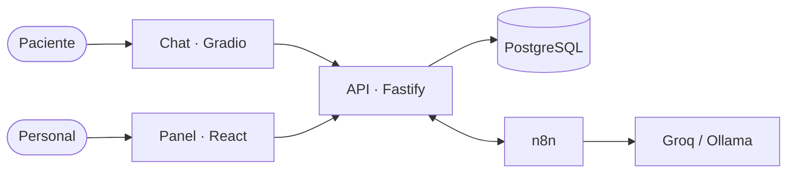

# SaludCita AI

**Sistema de agendamiento de citas médicas con un asistente conversacional.** El paciente reserva, consulta, cambia o
cancela sus citas escribiendo con sus palabras, en cualquier idioma, en un chat. El personal del hospital gestiona
citas, solicitudes de ayuda, horarios y estadísticas desde un panel web en tiempo real.

Proyecto académico del **Grupo G6**: Maestría en Ciencia de Datos e Inteligencia Artificial, Universidad Autónoma de
Santo Domingo (UASD), asignatura *Implementación de Robots y Máquinas Inteligentes*.

> **Todos los datos son ficticios.** El hospital, los médicos y los pacientes son inventados. El sistema solo hace gestión
> administrativa de citas: no diagnostica, no hace triaje y no guarda información clínica.



## Qué hace

**Para el paciente (chat «Salu»):**
- Reservar, cambiar y cancelar citas con un menú guiado o escribiendo con sus palabras («¿hay cardiólogo el martes por la mañana?»).
- Respuestas en el idioma del paciente, con horarios, médicos y precios **reales** de la base de datos.
- Tarjeta de confirmación obligatoria antes de cualquier cambio, comprobante en PDF, «Mis citas» y bandeja de avisos.
- Ofertas automáticas para adelantar la cita cuando se libera un horario antes.
- Acceso sin registro (sesión de invitado y código de recuperación) y opción de pedir ayuda al personal.

**Para el personal (panel administrativo):**
- Inicio en tiempo real: citas de hoy, asistencia, horarios libres, agenda y pendientes.
- Citas con filtros, detalle con historial y registro de asistencia.
- Solicitudes de ayuda: conversación previa del paciente, contacto, nota de resolución y aviso al paciente.
- Estadísticas de actividad, ocupación y adelantos.
- Configuración de médicos, especialidades, horarios y datos del centro, con vista previa del asistente.
- Permisos por rol: lectura, operación y administración.

| Panel: inicio en tiempo real | Panel: citas |
|---|---|
|  |  |

## Tecnologías

| Componente | Tecnología |
|---|---|
| API REST | Node.js 24, TypeScript, Fastify 5, OpenAPI 3.1 / Swagger |
| Base de datos | PostgreSQL 18 |
| Panel administrativo | React 19, Vite, Chart.js |
| Chat del paciente | Python 3.12, Gradio 6 |
| Orquestación | n8n Community 2.44 (autoalojado) |
| Modelo de lenguaje | Groq `gpt-oss-120b` (nube, gratis) con respaldo local Ollama + Qwen3 1.7B, o solo local |
| Infraestructura | Docker Compose; Caddy (HTTPS) en el servidor |
| Pruebas | Vitest (233 pruebas de la API), Playwright (interfaz) |

Detalle de cada tecnología, versiones y por qué se eligió: **[docs/tecnologias.md](docs/tecnologias.md)**.



**La IA interpreta y conversa; la API valida y ejecuta.** El modelo no accede a la base de datos ni puede reservar por su
cuenta: toda operación la confirma el paciente con un botón y la ejecuta la API dentro de una transacción.

## Instalación rápida

Requisitos: **Docker** (con 6 GB de memoria o más), **Git** y una terminal Bash. En Windows, usa Git Bash o WSL2.

```bash
git clone <url-del-repositorio> SaludCitaAI
```

```bash
cd SaludCitaAI
```

```bash
./scripts/bootstrap-env.sh
```

```bash
docker compose --env-file .env -f infra/compose.yaml --profile ai up -d --build
```

```bash
docker compose --env-file .env -f infra/compose.yaml --profile ai exec ollama ollama pull qwen3:1.7b
```

Después abre:

| Para | Dirección | Acceso |
|---|---|---|
| Pacientes (página del hospital con Salu) | http://127.0.0.1:7860 | Sin registro |
| Personal (panel) | http://127.0.0.1:8080/panel/ | `admin@saludcita.test` / `12345678` |
| Documentación de la API (Swagger) | http://127.0.0.1:8080/api/v1/docs | Pública |
| Flujos de n8n | http://127.0.0.1:5678 | Crear cuenta local la primera vez |

La **[guía de instalación](docs/instalacion.md)** explica cada paso, el recorrido de demostración, cómo activar Groq para
respuestas en ~1 s, cómo detener o borrar los datos, los problemas frecuentes y cómo ejecutar las pruebas.

## Estructura del repositorio

```text
apps/
  api/            API REST (TypeScript, Fastify): reglas de negocio, autenticación, OpenAPI; pruebas en test/ y evaluación del modelo en eval/
  admin-panel/    Panel administrativo (React + Vite + Chart.js), servido por la API en /panel/
  demo-gradio/    Chat del paciente (Python, Gradio) y página del hospital con el asistente flotante
database/
  migrations/     Esquema SQL versionado (up/down)
  seeds/          Datos ficticios reproducibles
workflows/n8n/    Flujos de n8n versionados (sin secretos)
infra/            Docker Compose (local, servidor y pruebas), Caddy e inicialización de PostgreSQL
contracts/        Contrato OpenAPI 3.1 generado, ejemplos JSON y colección de peticiones
scripts/          Configuración (.env), prueba de humo, demo trazable, copias de seguridad
tests/            Pruebas de interfaz (Playwright) y baterías de conversación
docs/             Documentación, decisiones, informes de cada entrega y capturas
```

## Documentación

| Documento | Contenido |
|---|---|
| [docs/instalacion.md](docs/instalacion.md) | **Cómo instalar, ejecutar, usar y probar** el sistema |
| [docs/tecnologias.md](docs/tecnologias.md) | **Tecnologías utilizadas**, arquitectura y flujo de una conversación |
| [docs/especificacion-sistema.md](docs/especificacion-sistema.md) | Especificación funcional y técnica |
| [docs/decisiones-implementacion.md](docs/decisiones-implementacion.md) | Decisiones tomadas durante la implementación |
| [docs/panel-administrativo.md](docs/panel-administrativo.md) | Guía del panel, roles y reglas |
| [docs/integracion-api.md](docs/integracion-api.md) | Uso de la API con ejemplos ([contrato OpenAPI](contracts/openapi.yaml)) |
| [docs/automatizaciones.md](docs/automatizaciones.md) | Flujos de n8n: conversación, ofertas, recordatorios, cola de trabajos |
| [docs/evaluacion-ia-local.md](docs/evaluacion-ia-local.md) | Evaluación de los modelos de lenguaje |
| [docs/estadisticas.md](docs/estadisticas.md) | Definición de cada indicador |
| [docs/despliegue-contabo.md](docs/despliegue-contabo.md) | Despliegue en un servidor con HTTPS |
| [docs/matriz-requisitos.md](docs/matriz-requisitos.md) | Requisitos, evidencias y pendientes |
| [docs/guion-demo.md](docs/guion-demo.md) | Guion para la demostración |
| [docs/entregas/](docs/entregas/) | Informe de cada entrega |
| [docs/proyecto/](docs/proyecto/) | Resumen del proyecto y Model Canvas (PDF) |

## Estado y limitaciones

- Funciona de punta a punta en local y en un servidor (VPS Contabo con HTTPS), con Groq como modelo principal y Qwen local como respaldo.
- **Google Calendar:** el flujo está preparado pero sin probar con una cuenta real (faltan credenciales OAuth).
- Los avisos al paciente solo se muestran en el chat: no se envían SMS, correos ni notificaciones al teléfono.
- En un ordenador sin tarjeta gráfica, el modelo local tarda entre 10 y 35 s por respuesta; con Groq, ~1 s.

## Equipo

Grupo G6, profesor **José Manuel Aquino Cepeda**:

- Bienvenido Cuevas
- Norman Carrasco
- Salvato Aponte
- Anthony Burgos
- Dariel Garo
- Ayzel Mateo

Santo Domingo, República Dominicana · octubre de 2026.
