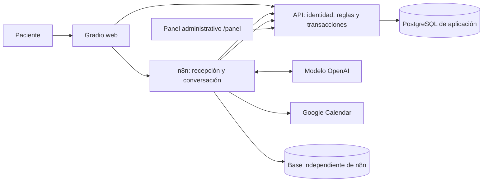
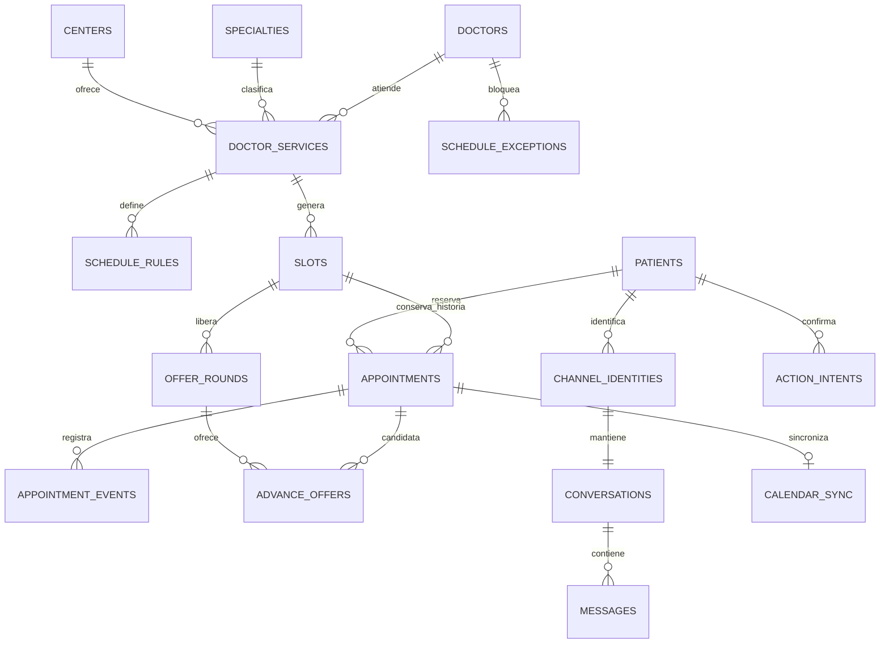

# SaludCita AI — especificación de arquitectura v1

> **Actualización 23-oct-2026 (cambio de responsabilidad):** el panel administrativo deja de asignarse a Norman. Lo construye el equipo como parte funcional del sistema (entrega 3B): se sirve desde la API en `/panel/` (mismo origen), con cookie HttpOnly, CSRF y permisos por rol. Ver [panel-administrativo.md](panel-administrativo.md).

Fecha: 23 de octubre de 2026. Estado: diseño para implementación, sin componentes programados ni desplegados. Las decisiones propuestas aquí son la base inicial; las credenciales y recursos externos requieren configuración.

Actualización de viabilidad: aplicar [referencias-y-viabilidad.md](referencias-y-viabilidad.md), que precisa campos de servicios/cancelación y establece herramientas sin suscripciones adicionales como prioridad. La IA inicial será candidata local con Ollama, sujeta a medición. Las menciones a OpenAI en este documento describen una alternativa opcional, no una dependencia obligatoria. No se asegura rendimiento del modelo local hasta probarlo.

## 1. Producto y responsables

Bot web en Gradio que conversa en español, busca disponibilidad real y permite reservar, consultar, reprogramar y cancelar citas de consulta externa. Automatiza recordatorios y ofrece adelantos cuando se liberan horarios. Usa información ficticia de un hospital simulado para la entrega universitaria.

El equipo define arquitectura, reglas, contratos y criterios de aceptación, e implementa código, migraciones, pruebas, despliegue y workflows n8n. El equipo desarrolla el panel administrativo (actualización 23-oct) y lo sirve desde la API.

El MVP incluye conversación natural, memoria persistente, agenda transaccional, adelantos secuenciales en cascada, calendario externo, métricas y operación reproducible. Excluye diagnóstico, triaje, historias clínicas, pagos, WhatsApp y conexión a hospitales reales. Una cuenta de demostración autenticada representa un paciente; familiares y tutores quedan fuera de esta versión.

## 2. Decisiones técnicas

| Elemento | Decisión inicial |
|---|---|
| Infraestructura | VPS Contabo con Linux; propuesta Ubuntu Server LTS compatible con Docker, versión por confirmar |
| Servicios | Docker Compose: proxy Caddy, Gradio, API, PostgreSQL y n8n Community |
| API | TypeScript, Node.js LTS, Fastify, validación de esquemas y OpenAPI 3.1 |
| Persistencia | PostgreSQL; migraciones SQL versionadas; acceso con consultas parametrizadas |
| Automatización | n8n orquesta mensajes de Gradio, IA, recordatorios, ofertas y calendario a través de la API |
| IA | AI Agent de n8n con modelo OpenAI y herramientas acotadas; `LLM_MODEL` configurable |
| Modelo inicial propuesto | GPT-4.1 mini como candidato de referencia con herramientas; validar acceso, compatibilidad del nodo, calidad y coste antes de fijarlo |
| Calendario | Google Calendar como propuesta inicial; calendario de demostración por médico |
| Tiempo | `timestamptz` para instantes; zona de negocio `America/Santo_Domingo`; intervalos [inicio, fin) |
| Panel | Panel administrativo del proyecto servido en `/panel/` por la API; permisos administrativos separados de los del bot |

No se necesita entrenar un modelo ni una base vectorial para consultar horarios. El modelo interpreta lenguaje y utiliza herramientas; las reglas se ejecutan en la API. Una base SQL responde a consultas exactas. El proveedor podrá cambiarse tras evaluar los mismos casos, sin reescribir la agenda. El consumo de IA y el VPS tienen presupuesto independiente; no se presupone que una suscripción de chat habilite credenciales de API.



El proxy publica HTTPS para Gradio y API. Los webhooks de conversación n8n son internos y autenticados. PostgreSQL no publica su puerto a Internet. La base de n8n tiene usuario y base separados dentro de la misma instancia PostgreSQL; n8n no escribe directamente en las tablas de negocio. La edición de workflows requiere acceso restringido. Un VPS único es un punto único de fallo aceptado para la demo, no alta disponibilidad.

## 3. Conversación y herramientas

Ejemplo: «Quiero una cita de cardiología el martes por la mañana». El bot obtiene fecha y zona de referencia del servidor, resuelve la fecha, pregunta si hay ambigüedad, consulta disponibilidad y presenta hasta tres opciones reales con fecha completa, médico y centro. La selección genera una intención pendiente; un botón de confirmación la ejecuta. Solo después del resultado exitoso de la API se envía número de cita y confirmación.

Herramientas disponibles: `list_specialties`, `list_doctors`, `search_availability`, `get_my_appointments`, `prepare_booking`, `prepare_cancellation`, `prepare_reschedule`, `get_my_offers`, `request_handoff`. Todas tienen esquemas estrictos y respuestas acotadas. Las consultas se limitan al paciente de la sesión.

El agente no recibe SQL, terminal, URLs arbitrarias, credenciales ni herramientas administrativas. La identidad del paciente proviene del usuario web autenticado y resuelto por la API, nunca de un `patient_id` elegido por el modelo. Los callbacks de confirmar/rechazar se procesan por un flujo determinista, fuera de la decisión del modelo. `confirm_intent` y `accept_offer` no son herramientas libres del agente.

Cada intención guarda operación, recursos y versión, parámetros y caducidad. El servidor genera un token aleatorio opaco, guarda su hash y vincula la acción al paciente. El callback valida sesión autenticada, paciente, token, plazo y estado. Elegir otro horario invalida la intención anterior. Una confirmación repetida devuelve el mismo resultado. Un botón viejo no modifica una cita reprogramada. Una intención no retiene un horario; el bot lo informa y revalida al confirmar.

Memoria: guardar estado estructurado (especialidad, preferencias, opciones e intención activa), resumen y últimos mensajes necesarios. No depender solo de memoria volátil del workflow. Serializar turnos por conversación mediante lease persistente y versión; recuperar leases vencidos después de reinicios. Máximo inicial de seis iteraciones de agente por turno y 30 segundos de presupuesto conversacional, ambos configurables. Si falla la IA, ofrecer menú guiado con las mismas APIs.

Pedir solo nombre y fecha de nacimiento ficticios al completar perfil; no pedir cédula, síntomas ni historial. Para consultas clínicas, explicar que el servicio gestiona citas y ofrecer asistencia administrativa. Una solicitud ambigua se aclara; el bot no asigna prioridades clínicas. El traspaso genera un caso consultable por personal, sin afirmar que alguien respondió si no ocurrió.

## 4. Modelo relacional

Convenciones: UUID para claves de negocio; `created_at`, `updated_at` en entidades mutables; claves foráneas con borrado restringido para historia de agenda; desactivación de catálogos con `active`. Estados mediante `CHECK` o enums versionados. Los campos listados son mínimos, no una migración ya ejecutada.

| Tabla | Campos principales y relaciones |
|---|---|
| `centers` | `id`, `name`, `address`, `timezone`, `active` |
| `specialties` | `id`, `name` único, `active` |
| `doctors` | `id`, `display_name`, `active` |
| `doctor_services` | `id`, `doctor_id` FK, `center_id` FK, `specialty_id` FK, `slot_minutes`, `active`; combinación única |
| `schedule_rules` | `id`, `doctor_service_id` FK, `weekday` 1–7, `local_start`, `local_end`, `valid_from`, `valid_until`; horarios semanales |
| `schedule_exceptions` | `id`, `doctor_id` FK, `starts_at`, `ends_at`, `reason`; bloqueos y ausencias |
| `slots` | `id`, `doctor_service_id` FK, `doctor_id` FK consistente con servicio, `starts_at`, `ends_at`, `status` open/blocked; una unidad de atención |
| `patients` | `id`, `full_name`, `birth_date`, `active`; un perfil ficticio por identidad en el MVP |
| `channel_identities` | `id`, `patient_id` FK, `channel`, `external_user_id`, `external_chat_id`; UNIQUE(channel, external_user_id); IDs externos como texto |
| `appointments` | `id`, `patient_id` FK, `slot_id` FK, `status` booked/cancelled/completed/no_show, `version`, `advance_opt_in`, `booked_at`, `cancelled_at` |
| `appointment_events` | `id`, `appointment_id` FK, `event_type`, `from_slot_id`/`to_slot_id` FK nullable, `actor_type`, `actor_id`, `occurred_at`, `correlation_id`; historial inmutable |
| `offer_rounds` | `id`, `slot_id` FK, `parent_round_id` FK nullable, `status` open/completed/exhausted/closed, `created_at`; una ronda abierta por slot |
| `advance_offers` | `id`, `round_id` FK, `appointment_id` FK, `original_slot_id` FK, `appointment_version`, `status` pending/accepted/rejected/expired/invalidated/delivery_failed, `expires_at`, `responded_at`; un candidato por ronda |
| `conversations` | `id`, `channel_identity_id` FK único, `state` JSONB validado, `summary`, `version`, `lease_until` |
| `messages` | `id`, `conversation_id` FK, `direction`, `provider_message_id`, `content`, `intent`, `model`, tokens, `latency_ms`, `created_at`; retención configurable |
| `action_intents` | `id`, `patient_id` FK, `conversation_id` FK, `kind`, `payload` JSONB validado, `token_hash`, `expires_at`, `status` pending/consumed/expired/invalidated, `result` JSONB |
| `inbound_updates` | `id`, `channel`, `external_update_id`, `payload` JSONB, `status`, `attempts`, `lease_until`, `last_error`; UNIQUE(channel, external_update_id) |
| `outbox_jobs` | `id`, `kind`, `aggregate_id`, `dedupe_key` único, `payload`, `status`, `available_at`, `attempts`, `lease_until`, `last_error`; trabajos durables |
| `notifications` | `id`, `patient_id` FK, `appointment_id`/`offer_id` FK nullable, `kind`, `dedupe_key` único, `status` pending/sent/failed/unknown, `provider_message_id`, `sent_at` |
| `calendar_bindings` | `id`, `doctor_id` FK único, `provider`, `external_calendar_id`, `enabled`; credenciales en n8n, no aquí |
| `calendar_sync` | `id`, `appointment_id` FK único, `binding_id` FK, `external_event_id`, `desired_version`, `synced_version`, `status`, `last_error`, `last_synced_at` |
| `analytics_events` | `id`, `event_type`, `occurred_at`, `patient_id`/`doctor_service_id`/`appointment_id` FK nullable, `correlation_id`, `dedupe_key` único, `metadata` sin texto clínico |
| `handoff_cases` | `id`, `patient_id` FK, `conversation_id` FK, `reason`, `status` open/resolved, `resolved_by`, `resolved_at` |
| `admin_users` | `id`, `email` único, `password_hash`, `role` viewer/operator/admin, `active` |
| `admin_sessions` | `id`, `admin_user_id` FK, `token_hash` único, `expires_at`, `revoked_at` |
| `service_credentials` | `id`, `name`, `secret_hash`, `scopes`, `expires_at`, `revoked_at`; acceso n8n separado de humanos |
| `idempotency_records` | `id`, `principal_id`, `route`, `key`, `request_hash`, `status`, `response_status`, `response_body`, `expires_at`; UNIQUE(principal_id, route, key) |



Integridad obligatoria: `starts_at < ends_at`, duración positiva, fecha de nacimiento no futura validada en API, índices en FKs y fechas de consulta. Evitar slots solapados por médico en todos sus servicios mediante exclusión GiST sobre médico y `tstzrange`, con `btree_gist`; no basta UNIQUE(inicio). El FK compuesto `(doctor_service_id, doctor_id)` debe asegurar que el médico corresponde al servicio.

Índice único parcial de cita por `slot_id WHERE status IN ('booked','completed','no_show')`; las canceladas conservan historia y liberan ocupación. Una única oferta pending por ronda y por cita mediante índices parciales; una única ronda open por slot. No confiar en estados expirados sin materializar: las transacciones procesan vencimientos bajo lock y siempre comprueban `expires_at`.

## 5. Agenda y concurrencia

Generar slots para los próximos 30 días a partir de reglas y excepciones, con tarea diaria idempotente. No borrar slots con historia. Un cambio de agenda bloquea slots futuros libres; los ya reservados requieren gestión explícita. Deshabilitar médico/servicio impide nuevas reservas, sin cancelar silenciosamente las existentes.

Toda reserva, cambio o aceptación se ejecuta en una transacción: bloquear paciente y slots afectados en orden estable, validar identidad, estados, fechas, servicio activo y ausencia de solapamientos del paciente. Todas las escrituras pasan por esos bloqueos; el índice parcial protege además la ocupación del slot. Reintentar deadlocks de forma limitada. La cita empieza siempre en el futuro; al comenzar ya no se acepta cancelación/reprogramación por bot. Plazos adicionales serán configurables, inicialmente sin anticipación mínima adicional.

Reserva: validar intención; bloquear slot; rechazar si existe cita ocupante u oferta pending no vencida; crear cita, evento y trabajos de notificación/calendario en la misma transacción; consumir intención y persistir resultado. La respuesta HTTP no espera a Google Calendar.

Reprogramación: mantener el mismo ID de cita; bloquear horario antiguo y nuevo; validar nuevo; mover `slot_id`, incrementar versión y guardar evento con ambos horarios. Liberar el antiguo e iniciar ronda de ofertas si corresponde. Si falla cualquier paso se conserva la cita original.

Cancelación: estado booked → cancelled, incrementar versión, registrar evento e iniciar ronda en la misma transacción. Repetir cancelación devuelve el estado actual, sin duplicar rondas ni avisos. Completed/no_show solo los marca personal autorizado después de la hora de inicio; el bot no acredita asistencia.

### Adelantos secuenciales y cascada

Elegibilidad: cita booked posterior al slot liberado, mismo `doctor_service_id` (mismo médico, centro, especialidad y duración), paciente con `advance_opt_in`, canal activo y sin conflicto horario. Es una restricción deliberada del MVP frente a permitir cualquier servicio del mismo médico. Orden: inicio de cita actual ascendente, después `booked_at` e ID como desempate. Registrar candidatos ya intentados por UNIQUE(round_id, appointment_id).

En cada ronda solo existe una oferta pending. El slot queda reservado para esa oferta y no aparece como disponible al público. La ventana normal es una hora; solo se emite una oferta si queda una hora completa antes del inicio del slot. Si no, cerrar la ronda y publicar el horario para reserva directa hasta su inicio. Un modo demo configurable reduce la ventana (por ejemplo 60 segundos), lo muestra explícitamente y no altera la regla normal.

Aceptar: bloquear ronda, oferta, paciente, cita y ambos slots; validar receptor, plazo, versión de cita y disponibilidad. Mover la cita atómicamente, marcar accepted, cerrar ronda e iniciar nueva ronda para el horario anterior si aún es elegible. La cascada solo se produce tras cada aceptación voluntaria. Ante carrera entre vencimiento y aceptación decide la transacción que valida el plazo bajo lock; el tiempo del servidor es autoritativo.

Rechazo o vencimiento: cerrar oferta y ofrecer al siguiente candidato elegible. Cancelar/mover la cita candidata invalida su oferta; bloquear un slot invalida ofertas y cierra ronda. Si no hay candidatos, cerrar como exhausted y volver a disponibilidad pública. Fallo definitivo de envío: delivery_failed y siguiente candidato; no afirmar que fue notificado. Un posible envío duplicado no permite aceptar dos veces.

## 6. Integraciones durables

Gradio: interfaz Python de chat con botones de confirmación y bandeja de avisos. El backend Gradio remite mensajes autenticados a la API; esta persiste `inbound_updates` y devuelve un ID. n8n reclama y procesa mensajes mediante endpoints internos autenticados. Gradio consulta el estado/resultado por ID con comprobación de propiedad, sin mantener conexiones abiertas indefinidamente. Una actualización repetida no genera una segunda operación. No exponer credenciales de servicio al navegador.

Identidad web: añadir `patient_accounts` (id, patient_id FK único, username único, password_hash, active) y `patient_sessions` (id, account_id FK, token_hash único, expires_at, revoked_at). Endpoints separados `/patient-auth/login`, `/logout`, `/me`. Cuentas ficticias creadas por seed; login con rate limit y sesiones revocables. El backend valida la sesión con la API en cada operación. No usar el nombre escrito, un selector público de pacientes o el identificador de sesión visual de Gradio como autenticación. Cookies seguras y CSRF según despliegue; no aceptar `patient_id` del navegador como prueba de identidad.

Outbox: n8n reclama lotes mediante endpoint con lease y `FOR UPDATE SKIP LOCKED`, ejecuta y confirma o comunica fallo. Backoff exponencial con jitter, máximo inicial cinco intentos, estado dead y reintento administrativo. Jobs abandonados se recuperan al vencer el lease. Procesar cada minuto recordatorios, vencimientos y pendientes. No mantener transacciones SQL abiertas mientras se llama a proveedores.

Recordatorios iniciales: 24 horas y una hora antes, únicamente si la cita sigue booked con la versión esperada y el instante programado aún es relevante. No enviar retrospectivamente los de una cita creada más cerca de su inicio. Cancelar/reprogramar invalida los jobs anteriores y genera los nuevos.

Calendario: sincronización unidireccional API → Google Calendar. Crear/actualizar/borrar evento según estado actual de cita; ID externo determinista compatible con el proveedor para reintentos. Usar `calendar_sync` y versión para evitar que un job viejo restaure una cita cancelada. Serializar jobs por cita; al completar, si apareció una versión nueva, dejar pendiente reconciliación. Registrar IDs y respuestas del proveedor. OAuth y refresh tokens en credenciales cifradas de n8n. Usar calendario de prueba sin edición manual como origen de disponibilidad; cambios manuales externos no se importan en el MVP y deben explicarse en la demo.

Avisos web: guardar notificaciones en PostgreSQL y añadir `GET /notifications` y `POST /notifications/{id}/read` con propiedad del paciente. Añadir `read_at` a notifications. `sent_at` significa publicado en bandeja, no leído ni recibido por un teléfono; lectura explícita mediante `read_at`. Consultar la bandeja periódicamente durante la sesión y al volver a entrar. Las ofertas pueden vencer estando el usuario desconectado: explicarlo y medir ese efecto. No se implementan push, SMS ni correo en el MVP. Telegram queda fuera del alcance inicial.

## 7. Contrato API (chat y panel administrativo)

Prefijo `/api/v1`; JSON; UUIDs; fechas RFC 3339 con offset. Paginación `limit` (máximo 100) y cursor; intervalos de filtros `[from,to)`. Respuesta de error `{error:{code,message,details},request_id}`. 400 validación, 401 sin autenticación, 403 sin permisos, 404 recurso no visible, 409 conflicto/versionado/idempotencia incompatible, 410 intención vencida, 429 límite, 503 dependencia temporal.

| Método y ruta | Función y acceso |
|---|---|
| `GET /health/live`, `/health/ready` | Vida de proceso y conexión DB; sin detalles sensibles |
| `GET /centers`, `/specialties`, `/doctors` | Catálogos autenticados; filtros por centro/especialidad |
| `GET /availability` | `doctor_service_id`, `from`, `to`; solo slots reservables |
| `POST /channel-identities/resolve` | Servicio de integración: resuelve identidad web previamente autenticada |
| `PATCH /patients/me` | Completar datos del paciente identificado por contexto validado |
| `GET /appointments` | Bot: solo propias; operador: filtros autorizados |
| `POST /action-intents` | Preparar booking/cancellation/reschedule con payload validado y versión esperada |
| `POST /action-intents/{id}/submit`, `GET /action-intents/{id}/confirmation` | Orden de confirmación (token, clave de idempotencia) que ejecuta n8n; estado de la orden |
| `GET /offers` | Ofertas del paciente en contexto |
| `POST /offers/{id}/answer`, `GET /offers/{id}/answer` | Respuesta a un adelanto (aceptar/rechazar) como orden que ejecuta n8n; estado |
| `POST /handoffs` | Crear solicitud de ayuda administrativa |
| `GET /handoffs`, `PATCH /handoffs/{id}` | Operador: consulta y resolución |
| `POST /appointments/{id}/attendance` | Operador: completed/no_show tras inicio, con versión esperada |
| `POST /internal/updates`, `/internal/updates/claim` | Persistir/reclamar actualizaciones; solo servicio de integración |
| `POST /internal/updates/{id}/route`, `/branch/{route}`, `/draft`, `/fail` | Decidir la rama del mensaje, ejecutarla, entregar la redacción o reintentar |
| `POST /internal/commands/claim`, `/internal/commands/{id}/confirm`, `/offer-answer`, `/receipt`, `/reminder`, `/guest-cleanup`, `/fail` | Comandos durables ejecutados por n8n (lease) |
| `POST /internal/jobs/claim`, `/internal/jobs/{id}/ack`, `/fail` | Cola durable, con token de lease |
| `POST /internal/scheduler/tick` | Generar slots, materializar vencimientos y recordatorios; idempotente |
| `GET /stats/summary`, `/stats/timeseries` | Resumen e indicadores en el tiempo |
| `GET /stats/doctors`, `/stats/specialties`, `/stats/occupancy`, `/stats/offers` | Agrupaciones para el panel |
| `GET /admin/integrations`, `/admin/jobs` | Estado de proveedores y fallos, sin secretos |
| `POST /admin/jobs/{id}/retry` | Reintento controlado, solo operador/admin |
| `POST /auth/login`, `/auth/logout`, `GET /auth/me` | Sesión administrativa y rol |

Contexto de bot: el backend Gradio valida la sesión mediante la API y n8n autenticado propaga el contexto de identidad validado; se rechazan esas cabeceras de clientes sin scope de integración. La API resuelve el paciente y aplica propiedad a cada consulta. El modelo no controla dichas cabeceras. Cabecera `Idempotency-Key` para escrituras, hash canónico de cuerpo y respuesta persistida junto con operación; misma clave con distinto cuerpo → 409. Dedupe keys de proveedores se conservan durante toda la demo.

Operaciones de mantenimiento (CRUD de catálogos, reglas, excepciones) se añaden como endpoints administrativos antes de construir los formularios de edición del panel; no bloquear la primera integración de estadísticas por estos formularios. Se debe generar el OpenAPI completo, ejemplos y colección de peticiones antes de integrar el panel. Esta tabla es el inventario de rutas, todavía no un contrato OpenAPI ejecutable.

Autenticación humana: password hash resistente, rate limit en login, sesión revocable con cookie HttpOnly/Secure. Preferir publicar el panel bajo el mismo origen del proxy; si un cliente externo usa otro dominio, configurar CORS con allowlist, cookies, CSRF y política SameSite acorde al despliegue. No usar una clave administrativa estática dentro de JavaScript público. Scopes de servicio separados: bot, scheduler y calendar-sync. Un token de servicio nunca sustituye las comprobaciones de propiedad del paciente.

## 8. Estadísticas que consume el panel

Filtros comunes `from`, `to`, `center_id`, `doctor_id`, `specialty_id`; responder con filtros, zona horaria, `generated_at` y definición de unidad. Agregaciones sin nombres, chats ni mensajes de pacientes.

| Indicador | Definición |
|---|---|
| Búsquedas | Eventos deduplicados de consulta de disponibilidad, aunque no terminen en reserva |
| Reservas/cancelaciones/cambios | Eventos confirmados por fecha de operación, no conteo de mensajes ni ejecuciones n8n |
| Agenda por periodo | Citas según inicio actual del slot; devolver estados por separado |
| Ocupación | Slots con booked/completed/no_show / slots habilitados en el periodo de atención; ofertas pendientes separadas; devolver numerador y denominador |
| Asistencia | completed y no_show marcados por operador; no inferir de una reserva |
| Ofertas | pending, accepted, rejected, expired, invalidated y delivery_failed |
| Recuperación | Slots cancelados elegibles que se volvieron a ocupar antes del inicio / slots cancelados elegibles; contar slots distintos e indicar hora de corte |
| Adelanto | Diferencia entre inicio anterior y nuevo en cada evento de aceptación; media, mediana y número de casos |
| Calidad del bot | Éxito por operación, fallos, aclaraciones, derivaciones, latencia y tokens; errores confirmados se verifican con resultados de API |

Series por día local; días vacíos con cero. Evitar mezclar cohortes por fecha de búsqueda y fecha de cita. Conversión de búsqueda a reserva se pospone hasta definir atribución. Edad solo agregada con fecha de referencia y grupos definidos si se usa en evaluación; no es necesaria para el primer panel.

## 9. Workflows a implementar

1. Entrada Gradio: validar, persistir y deduplicar; encolar para procesamiento.
2. Conversación: reclamar actualización, bloquear conversación con lease, recuperar contexto, resolver identidad, llamar agente con herramientas, guardar estado y responder.
3. Callbacks: validar identidad y token, confirmar operación transaccional, enviar resultado de API sin inventarlo.
4. Scheduler: cada minuto reclamar vencimientos y trabajos; generación de agenda diaria idempotente.
5. Notificaciones: ofertas, confirmaciones y recordatorios con trazabilidad y reintentos.
6. Calendario: aplicar estado vigente, guardar resultado y reconciliar fallos.
7. Errores: registrar workflow, request ID y categoría; ofrecer estado administrativo y reintento. No guardar tokens en logs.

## 10. Estructura del repositorio

```text
apps/api/src/
  modules/{catalog,patients,scheduling,appointments,offers,conversation,analytics,auth,integrations}/
  plugins/  config/  shared/
database/migrations/  database/seeds/
contracts/openapi.yaml
workflows/n8n/                 # JSON exportados sin secretos
infra/compose.yaml  infra/Caddyfile
scripts/                       # bootstrap, backup, restore y smoke test
tests/{integration,e2e,conversation}/
docs/                          # arquitectura, operación e integración del panel
.env.example                   # nombres y ejemplos ficticios
```

## 11. Entregas y pruebas de aceptación

1. Infraestructura reproducible, migraciones, seed (un centro, tres especialidades, seis médicos, 20 pacientes ficticios y 30 días de slots) y OpenAPI validado.
2. API funcional: 20 reservas concurrentes del mismo slot producen exactamente una cita activa; reintentar la misma clave devuelve mismo ID; reprogramación fallida conserva original; un paciente no consulta ni modifica citas ajenas.
3. Gradio e IA: recordar contexto tras reinicio, resolver fecha relativa con zona, aclarar «el martes» ambiguo, confirmar mediante botón y mostrar una cita persistida real. Mensaje duplicado y callback repetido no duplican cambios. Intentos de inventar IDs o pedir SQL no amplían permisos.
4. Adelantos: aceptación, rechazo, vencimiento, notificación fallida, cita candidata modificada, ronda agotada, slot cercano al inicio y cascada de al menos dos aceptaciones. Carrera entre reserva y oferta y entre aceptación y expiración mantiene integridad.
5. Calendario y recordatorios: crear, actualizar y cancelar el mismo evento; simular timeout, reordenamiento de jobs y reinicio; la cita y el calendario convergen al estado más reciente. No se envían recordatorios de versiones canceladas.
6. API del panel: respuestas con ejemplos, filtros, denominadores y datos conciliables con SQL y eventos. Login, roles y CORS se prueban con origen autorizado y no autorizado.
7. Operación: reiniciar contenedores conserva datos; restaurar backup en entorno separado y ejecutar smoke test. Demostración integral desde Gradio hasta PostgreSQL, calendario y estadísticas.

Evaluación de IA: mínimo 30 casos reproducibles etiquetados por operación y claridad (incluyendo errores tipográficos, contexto, ambigüedad y peticiones fuera de alcance). Medir éxito correcto, confirmaciones incorrectas, aclaraciones, latencia y consumo. Objetivo obligatorio: cero confirmaciones de citas inexistentes y cero accesos entre pacientes; repetir la misma batería ante cambios de modelo/prompt. Comparar una muestra con menú/manual simulado bajo condiciones iguales; los resultados no prueban mejoras en un hospital real.

## 12. Operación y pendientes externos

SSH con clave, firewall, HTTPS, secretos fuera de Git, volúmenes persistentes, healthchecks, reinicio automático y logs con request IDs. Backup diario cifrado fuera del VPS de bases y claves/configuración necesarias para restaurar n8n; definir retención y probar restauración. Fijar versiones de imágenes tras validarlas, sin `latest`. Proteger la clave de cifrado de n8n y guardarla con el procedimiento de recuperación.

Pendientes que no impiden programar localmente: recursos y Linux del VPS, IP, dominio/DNS, cuentas ficticias y sesiones Gradio, cuenta/calendarios de prueba Google y OAuth, clave OpenAI con presupuesto, dominio/origen del panel y destino de backups. Google Calendar y el modelo son propuestas iniciales; deben verificarse con credenciales reales antes de cerrar integración. No incluir contraseñas ni claves en documentación compartida por chat.

## 13. Fuentes técnicas consultadas

- n8n AI Agent: https://docs.n8n.io/integrations/builtin/cluster-nodes/root-nodes/n8n-nodes-langchain.agent
- OpenAI herramientas: https://developers.openai.com/api/docs/guides/function-calling
- Modelo candidato: https://developers.openai.com/api/docs/models/gpt-4.1-mini
- PostgreSQL restricciones: https://www.postgresql.org/docs/current/ddl-constraints.html
- Google Calendar: https://developers.google.com/workspace/calendar/api/guides/create-events


## 14. Interfaz Gradio y alcance académico actualizado

Gradio es el canal principal del paciente y sustituye a Telegram en el MVP. Mantener `channel_identities` con `channel=gradio` y usuario externo vinculado a la cuenta autenticada para no acoplar la agenda a la interfaz. Las tablas de cuentas y sesiones de pacientes son adicionales a las sesiones administrativas.

Añadir `apps/demo-gradio/` con código Python y dependencias fijadas y servicio Gradio en Compose. Tema SaludCita AI con chat, opciones claras de horarios, fecha completa, médico y centro, botones de confirmación, listado de citas y bandeja de avisos. Componentes de presentación sin lógica de agenda duplicada. Probar accesibilidad básica, estados de carga/error, aislamiento entre sesiones y uso en pantalla pequeña.

Toda la implementación se desarrolla y prueba localmente antes del despliegue posterior en Contabo. Entregar código fuente, migraciones, datos ficticios, workflows n8n exportados, dependencias fijadas, OpenAPI, pruebas y README reproducible desde copia limpia. Las credenciales de terceros se documentan como prerrequisitos y no se incluyen en el código.

Registrar resultados verificables por operación, especialidad y claridad de solicitud para la evaluación final. La entrega académica posterior incluye demo Gradio, informe PDF, evaluación por subgrupo, reflexión ética ligada a las decisiones del prototipo y Canvas actualizado con evidencia, además de enlaces abiertos a las evidencias autorizadas en Drive. No declarar estas piezas terminadas ni publicar recursos externos automáticamente.
