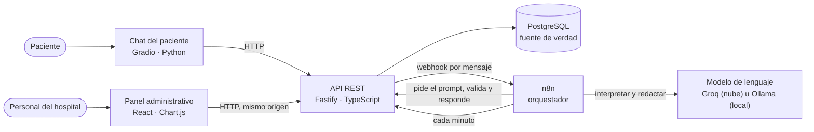
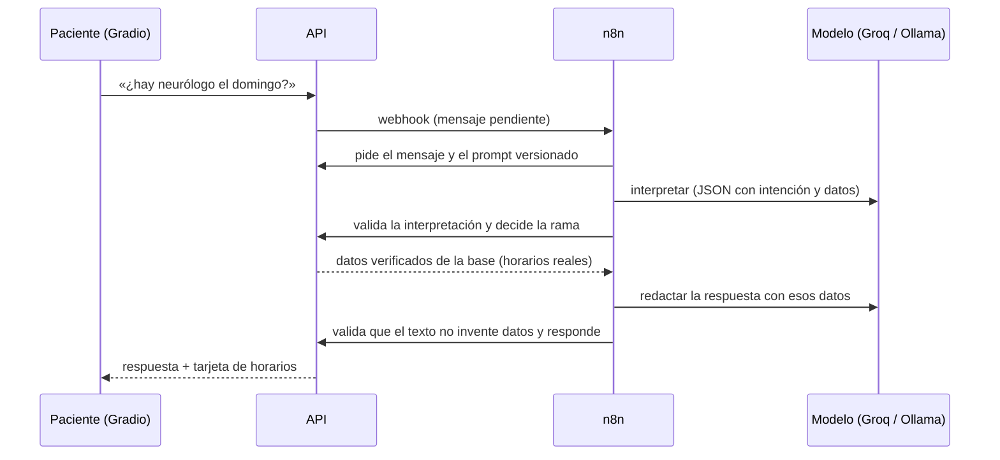

# Tecnologías utilizadas

SaludCita AI combina servicios pequeños, cada uno con una responsabilidad clara, que se levantan juntos con Docker
Compose. Todas las versiones están fijadas en el código para que la instalación sea reproducible.

## Visión general

**Principio de diseño:** *la IA interpreta y conversa; la API valida y ejecuta.* El modelo de lenguaje nunca toca la base
de datos, no elige la identidad del paciente y no puede reservar ni cancelar por su cuenta: toda operación pasa por una
intención que el paciente confirma con un botón y que la API ejecuta dentro de una transacción.

## Tecnologías por capa

| Capa | Tecnología | Versión | Para qué se usa |
|---|---|---|---|
| Contenedores | Docker + Docker Compose v2 | Compose 2.x | Levantar todos los servicios con un solo comando, igual en cualquier equipo |
| Base de datos | PostgreSQL | 18.6 (Alpine) | Fuente de verdad: catálogos, agenda, citas, conversaciones, avisos, auditoría. Restricciones de exclusión impiden dobles reservas |
| API | Node.js + TypeScript + Fastify | Node 24 LTS, TypeScript 7, Fastify 5.12 | API REST con validación de esquemas (TypeBox), autenticación, reglas de negocio y documentación OpenAPI |
| Acceso a datos | `pg` (node-postgres) | 8.23 | SQL directo y transacciones explícitas (sin ORM) |
| Documentación de la API | OpenAPI 3.1 + Swagger UI | `@fastify/swagger` 9.9 | Contrato generado desde el código (`contracts/openapi.yaml`) y explorador en `/api/v1/docs` |
| Panel administrativo | React + Vite + Chart.js | React 19.3, Vite 8.3, Chart.js 4.6 | Interfaz del personal: inicio en vivo, citas, solicitudes de ayuda, estadísticas y configuración. La API lo sirve en `/panel/` |
| Chat del paciente | Python + Gradio | Python 3.12, Gradio 6.30 | Interfaz tipo mensajería con menú guiado, tarjetas de confirmación, «Mis citas» y avisos; widget flotante «Salu» |
| Orquestación | n8n Community (autoalojado) | 2.44.6 | Flujos versionados en `workflows/n8n/`: conversación (llama al modelo y a la API), planificador cada minuto (ofertas, recordatorios, reintentos), comandos y Google Calendar (borrador) |
| Modelo de lenguaje (principal) | Groq, API compatible con OpenAI | `openai/gpt-oss-120b` | Entender lo que escribe el paciente (intención y datos en JSON validado) y redactar respuestas naturales en su idioma. Plan gratuito |
| Modelo de lenguaje (local / respaldo) | Ollama + Qwen3 | Ollama 0.40.6, `qwen3:1.7b` (Apache 2.0) | Funciona sin internet ni claves. Con Groq configurado actúa como respaldo automático si Groq falla |
| Proxy HTTPS (solo servidor) | Caddy | 2.11.7 | Certificados HTTPS automáticos y cabeceras de seguridad en el despliegue |
| Pruebas de la API | Vitest | 5.0 | 233 pruebas de integración contra PostgreSQL real (concurrencia, idempotencia, permisos, conversación) |
| Pruebas de interfaz | Playwright + axe-core | Playwright 1.64 | Recorridos de punta a punta en navegador (panel y chat) y accesibilidad |
| Comprobante de cita | PDF generado en la API | — | Comprobante descargable desde «Mis citas» |

Las versiones exactas de cada dependencia están en `apps/api/package.json`, `apps/admin-panel/package.json`,
`apps/demo-gradio/requirements.txt`, `tests/e2e/package.json` y las imágenes de `infra/compose.yaml`.

## Cómo fluye una conversación

- Si el modelo falla o tarda demasiado, el paciente recibe el **menú guiado** (sin IA), que permite hacer todo igual.
- Las respuestas redactadas por el modelo se comprueban contra los datos verificados (números, médicos, contactos); si
  no coinciden se usa el texto verificado.
- Las reservas, cambios y cancelaciones **siempre** requieren pulsar «Confirmar» en una tarjeta.

## Proveedor del modelo: local o en la nube

| Opción | Configuración en `.env` | Ventajas | Limitaciones |
|---|---|---|---|
| Solo local (por defecto) | `LLM_PROVIDER=ollama`, `OLLAMA_MODEL=qwen3:1.7b` | Sin cuentas ni claves; nada sale del equipo | Lento en CPU (10–35 s por llamada) y entiende peor frases complejas |
| Groq + respaldo local (recomendado) | `LLM_PROVIDER=openai`, `LLM_API_KEY=<clave gratuita>`, `LLM_API_MODEL=openai/gpt-oss-120b`, `LLM_FALLBACK=ollama` | ~1 s por llamada, conversación natural en cualquier idioma | Límite gratuito (~40–50 mensajes al día); al agotarse responde el modelo local |

La clave del proveedor **solo vive en la API**: n8n llama a una pasarela interna (`/api/v1/internal/llm/chat`) que añade
la clave, traduce el formato y, si el proveedor falla, reenvía la petición al modelo local.

## Seguridad y privacidad (resumen)

- Datos **ficticios**: pacientes, médicos, teléfonos `(809) 555-…` y correos `.test` / `.example`.
- Contraseñas con *scrypt*; tokens opacos guardados como hash; límite de intentos en los inicios de sesión.
- Panel con cookie `HttpOnly` + token CSRF y permisos por rol (`viewer`, `operator`, `admin`) aplicados en la API.
- Pacientes invitados con cookie de dispositivo y código de recuperación; nunca basta con nombre o fecha de nacimiento.
- PostgreSQL, la API y n8n se publican solo en `127.0.0.1` en local; en el servidor, solo Caddy (puertos 80/443).
- `.env`, claves, volúmenes de datos y documentos internos están excluidos de Git.

Más detalle: [especificacion-sistema.md](especificacion-sistema.md), [decisiones-implementacion.md](decisiones-implementacion.md)
y [evaluacion-ia-local.md](evaluacion-ia-local.md).
